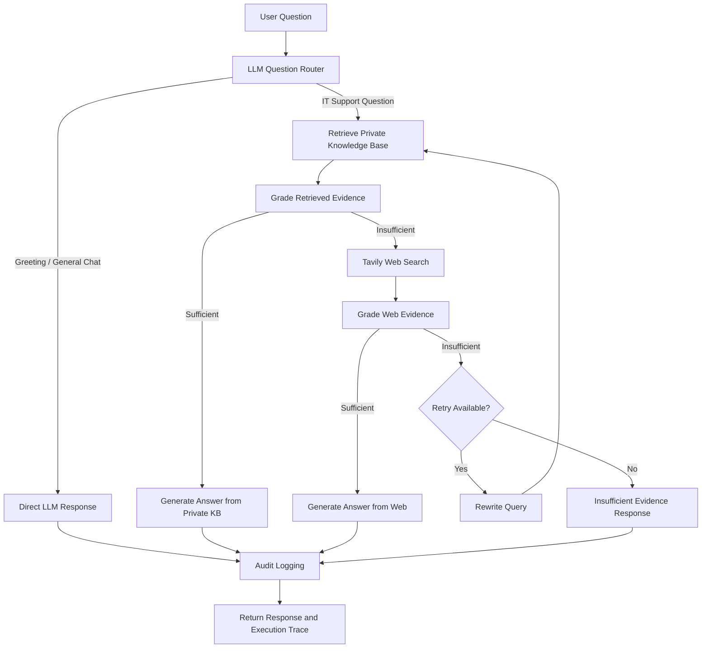

# Enterprise IT Support System Using Agentic RAG

An AI-powered enterprise IT support assistant built using **Agentic RAG, LangGraph, FastAPI, Groq, Pinecone, and Tavily**. The system retrieves answers from a private IT knowledge base, evaluates retrieved evidence, falls back to external web search when necessary, and provides source-aware responses with execution traces.

## Overview

Enterprise IT support teams frequently handle repetitive requests related to VPN connectivity, password resets, MFA configuration, software access, device troubleshooting, and internal IT policies.

Traditional knowledge-base search systems rely heavily on keyword matching and may struggle when users phrase questions differently or when relevant information is unavailable.

This project implements an **Agentic Retrieval-Augmented Generation (RAG)** system that uses an LLM-driven workflow to determine how each question should be handled.

Instead of relying on a single retrieval-and-generation step, the system evaluates retrieved information and conditionally routes questions through different processing paths.

### Key Features

- **Agentic Workflow Orchestration:** Uses LangGraph to coordinate question routing, retrieval, evidence evaluation, query rewriting, and response generation.
- **Private Knowledge Base Retrieval:** Uses Pinecone vector search to retrieve relevant enterprise IT documentation.
- **Evidence Grading:** Evaluates whether retrieved knowledge-base content is sufficient to answer a question.
- **Web Search Fallback:** Uses Tavily Search when private knowledge-base evidence is insufficient.
- **Query Rewriting:** Refines unsuccessful queries to improve subsequent retrieval attempts.
- **Direct LLM Responses:** Handles greetings and general conversational inputs without unnecessary retrieval.
- **Source Attribution:** Returns source information for private knowledge-base and external web responses.
- **Execution Trace:** Exposes the agent's processing steps to make workflow decisions easier to inspect.
- **Document Ingestion:** Supports PDF, TXT, Markdown, and DOCX documents.
- **Audit Logging:** Stores user questions, selected information sources, timestamps, and execution traces in SQLite.
- **Web Application:** Provides an interactive IT support interface powered by FastAPI.

## Architecture

The application uses a conditional Agentic RAG workflow to select the appropriate response path.

### Workflow

1. **Question Routing:** The LLM classifies incoming messages as IT knowledge-base questions or direct conversational requests.
2. **Knowledge Retrieval:** IT-related questions trigger semantic retrieval from the private Pinecone knowledge base.
3. **Evidence Evaluation:** An LLM-based grader evaluates whether the retrieved documents contain sufficient information.
4. **Conditional Routing:**
   - If private evidence is sufficient, the system generates an answer using the internal knowledge base.
   - If private evidence is insufficient, the system searches external sources using Tavily.
5. **Web Evidence Evaluation:** External search results are evaluated for relevance and sufficiency.
6. **Query Rewriting:** If external evidence is insufficient and retries remain, the system rewrites the query and attempts retrieval again.
7. **Response Generation:** The system generates an answer from the selected evidence or returns an insufficient-evidence message.
8. **Audit Logging:** The question, selected source, and execution trace are recorded in SQLite.

### Agentic RAG Workflow Diagram



## Technology Stack

| Category | Technologies |
|---|---|
| Programming Language | Python |
| Backend Framework | FastAPI |
| Agent Orchestration | LangGraph |
| LLM Integration | Groq |
| Language Model | GPT-OSS 20B via Groq |
| Retrieval-Augmented Generation | LangChain |
| Vector Database | Pinecone |
| Embeddings | Hugging Face Sentence Transformers |
| External Search | Tavily |
| Document Processing | PyPDF, python-docx, TextLoader |
| Text Splitting | RecursiveCharacterTextSplitter |
| Database | SQLite |
| Frontend | HTML, CSS, JavaScript, Jinja2 |
| Deployment | Docker |

## Project Structure

```text
IT-Support-System-Using-Agentic-RAG/
│
├── app/
│   ├── api/
│   │   └── routes.py
│   │
│   ├── core/
│   │   ├── config.py
│   │   └── logging.py
│   │
│   ├── rag/
│   │   ├── state.py
│   │   ├── workflow.py
│   │   └── vectorstore.py
│   │
│   ├── services/
│   │   ├── ingestion.py
│   │   └── audit.py
│   │
│   └── main.py
│
├── data/
│   └── sample_kb/
│
├── static/
│   ├── css/
│   └── js/
│
├── templates/
│   └── index.html
│
├── uploads/
│
├── Dockerfile
├── requirements.txt
├── run.py
├── create_project.py
├── ingest_sample_kb.py
└── README.md
```

## Getting Started

### 1. Clone the Repository

```bash
git clone https://github.com/Hitarth10298/IT-Support-System-Using-Agentic-RAG.git

cd IT-Support-System-Using-Agentic-RAG
```

### 2. Create a Virtual Environment

```bash
python -m venv venv
```

Activate the environment:

**Windows**

```bash
venv\Scripts\activate
```

**macOS / Linux**

```bash
source venv/bin/activate
```

### 3. Install Dependencies

```bash
pip install -r requirements.txt
```

Install the additional integration packages required by the current implementation:

```bash
pip install langchain-groq langchain-huggingface sentence-transformers
```

### 4. Configure Environment Variables

Create a `.env` file in the project root directory.

```env
APP_NAME=Enterprise IT Support Agentic RAG Copilot
APP_ENV=development

# Groq Configuration
GROQ_API_KEY=your_groq_api_key
GROQ_MODEL=openai/gpt-oss-20b

# Tavily Configuration
TAVILY_API_KEY=your_tavily_api_key

# Pinecone Configuration
PINECONE_API_KEY=your_pinecone_api_key
PINECONE_INDEX_NAME=it-support-rag
PINECONE_NAMESPACE=company-it-kb

# Embedding Configuration
EMBEDDING_MODEL=sentence-transformers/all-MiniLM-L6-v2

# Retrieval Configuration
TOP_K=4
MAX_RETRIES=1

# Admin Authentication
ADMIN_API_KEY=replace_with_a_strong_random_secret
```

**Required API credentials:**

- Groq: https://console.groq.com/
- Pinecone: https://www.pinecone.io/
- Tavily: https://tavily.com/

The application uses Groq for LLM inference, Pinecone for vector storage, and Tavily for external web search.

The embedding model is configured to use a local Hugging Face Sentence Transformers model.

### 5. Prepare the Knowledge Base

Place enterprise IT support documents inside:

```text
data/sample_kb/
```

Supported document formats:

- PDF
- TXT
- Markdown
- DOCX

Example knowledge-base documents:

```text
data/sample_kb/
├── vpn_troubleshooting.pdf
├── password_reset.pdf
├── mfa_setup.pdf
├── laptop_setup.docx
└── software_access.md
```

These documents serve as the private knowledge source for the IT support assistant.

### 6. Ingest Documents into Pinecone

Run the ingestion script:

```bash
python ingest_sample_kb.py
```

The ingestion pipeline:

1. Loads supported documents.
2. Extracts their text content.
3. Splits documents into smaller chunks.
4. Generates embeddings.
5. Stores document vectors in the configured Pinecone index and namespace.

The configured text splitter uses a chunk size of 900 characters and an overlap of 120 characters.

### 7. Run the Application

Start the FastAPI application:

```bash
uvicorn app.main:app --reload
```

Open the application in your browser:

```text
http://127.0.0.1:8000
```

FastAPI API documentation:

```text
http://127.0.0.1:8000/docs
```

## API Endpoints

The application exposes the following REST API endpoints:

| Method | Endpoint | Description |
|---|---|---|
| GET | `/` | Serves the IT support web interface |
| GET | `/api/health` | Checks application health |
| POST | `/api/chat` | Processes user questions through the Agentic RAG workflow |
| POST | `/api/ingest` | Uploads and indexes knowledge-base documents |

### Chat Endpoint

**Request**

```http
POST /api/chat
Content-Type: application/json
```

```json
{
  "question": "How do I reset my company VPN connection?"
}
```

**Response structure**

```json
{
  "answer": "Answer generated using the available evidence.",
  "source_used": "private_kb",
  "trace": [
    "Router → KB",
    "Private KB retrieval → 4 chunks",
    "KB evidence grade → GOOD",
    "Answer generation → PRIVATE KB"
  ],
  "citations": [
    {
      "title": "vpn_troubleshooting.pdf",
      "url": "",
      "type": "private_kb"
    }
  ],
  "rewritten_query": "How do I reset my company VPN connection?"
}
```

The response structure illustrates the API contract; actual answers, trace messages, and citations depend on the question and retrieved documents.

### Document Ingestion Endpoint

**Request**

```http
POST /api/ingest
```

Required request header:

```http
x-admin-key: your_admin_api_key
```

Upload a supported file using multipart form data with the field name `file`.

The endpoint validates the admin key and file extension before processing and indexing the uploaded document.

## Docker Deployment

Build the Docker image:

```bash
docker build -t enterprise-it-support-rag .
```

Run the container:

```bash
docker run --env-file .env -p 8080:8080 enterprise-it-support-rag
```

Open:

```text
http://localhost:8080
```

The application listens on port 8080 inside the container.

## Example Use Cases

The system is designed to support common enterprise IT scenarios.

| User Query | Expected Processing |
|---|---|
| How do I reset my VPN connection? | Private knowledge-base retrieval |
| What is the company's MFA setup process? | Private knowledge-base retrieval |
| How can I request software access? | Private knowledge-base retrieval |
| What is a general greeting? | Direct LLM response |
| Private documentation does not contain the requested information | External web-search fallback |
| Neither source provides sufficient evidence | Insufficient-evidence response |

The actual response depends on the documents indexed in the private knowledge base and the relevance of external search results.

## Audit Logging

The application uses SQLite to maintain a record of processed questions.

The audit records include:

- Query timestamp
- User question
- Selected information source
- Agent execution trace

This provides visibility into the source selection and processing path for individual requests.

## Security Considerations

- Store API keys in environment variables rather than hardcoding credentials.
- Configure a strong, unique admin API key before exposing the ingestion endpoint.
- Restrict access to document ingestion and uploaded files.
- Do not upload confidential company documents to an unapproved external service.
- Validate external search results before applying information to company-managed systems.
- Configure appropriate authentication, authorization, and network protections before production deployment.

This repository is a development project and should not be considered production-hardened without additional security, testing, and deployment controls.

## Current Scope and Limitations

- Response quality depends on the quality and coverage of indexed documents.
- External web-search results may not reflect internal company policies.
- The application uses a configurable, limited retry mechanism for unsuccessful retrieval.
- SQLite provides local audit persistence rather than a distributed audit infrastructure.
- Production deployment requires additional authentication, authorization, monitoring, and operational hardening.

## Future Enhancements

- Integrate enterprise identity providers and role-based access control.
- Add conversation memory and multi-turn support workflows.
- Implement document-level access permissions.
- Introduce retrieval evaluation and answer-quality metrics.
- Add more advanced retrieval strategies and reranking.
- Integrate IT Service Management platforms such as ServiceNow.
- Expand observability, monitoring, and production deployment capabilities.

## Acknowledgements

This project was developed as a guided implementation, drawing on the Agentic RAG enterprise IT support project by [entbappy](https://github.com/entbappy/Enterprise-IT-Support-Agentic-RAG-Copilot).

The repository documents the implementation and technology configuration used in this version.

## Author

**Hitarth Shah**

M.S. Computer Science | Applied AI & Generative AI

GitHub: https://github.com/Hitarth10298

LinkedIn: https://www.linkedin.com/in/hitaarthshah1/

---

If you find this project useful, consider giving the repository a ⭐.
